  <picture>
    <source media="(prefers-color-scheme: dark)" srcset="https://raw.githubusercontent.com/tepmehatop/tepmehatop/main/profile/banner-dark.svg">
    <source media="(prefers-color-scheme: light)" srcset="https://raw.githubusercontent.com/tepmehatop/tepmehatop/main/profile/banner-light.svg">
    
  </picture>

<h3 align="center">Hi, I'm Mark 👋 — QA automation engineer</h3>

Playwright · test infrastructure · STM32 / ESP32 tinkering

---

### 🎮 Play Bug Hunt

Catch bugs before they reach production. Made with Svelte, runs right in your browser.
| [@tepmehatop](https://github.com/tepmehatop) | A | clean · warm |

<!-- BUGHUNT:END -->

---

Pixel people & furniture: [Pixel Agents](https://github.com/pablodelucca/pixel-agents) (MIT) based on [Metro City](https://jik-a-4.itch.io/metrocity-free-topdown-character-pack) by JIK-A-4 (CC0) · font: [Pixelify Sans](https://github.com/eifetx/Pixelify-Sans) (OFL) · the banner redraws itself daily with GitHub Actions
