  <picture>
    <source media="(prefers-color-scheme: dark)" srcset="https://raw.githubusercontent.com/tepmehatop/tepmehatop/main/profile/banner-dark.svg">
    <source media="(prefers-color-scheme: light)" srcset="https://raw.githubusercontent.com/tepmehatop/tepmehatop/main/profile/banner-light.svg">
    
  </picture>

<h3 align="center">Hi, I'm Mark 👋 — QA automation engineer</h3>

Playwright · test infrastructure · STM32 / ESP32 tinkering

---

### 🎮 Play Bug Hunt

Catch bugs before they reach production. Made with Svelte, runs right in your browser.

### 🐛 Office Bug Hunt — play right here

<!-- BUGHUNT:START -->

**Where is the bug hiding?** Pick a desk — an issue opens, press **Submit**, and in ~30 s your character walks in and checks it. Clean desks give a hint: 🔥 hot (next door) · 🌤️ warm · 🧊 cold.

| | | | |
|:-:|:-:|:-:|:-:|
| [**A**](https://github.com/tepmehatop/tepmehatop/issues/new?title=bughunt%7Ccheck%7CA&body=Just%20press%20**Submit%20new%20issue**%20%E2%80%94%20a%20GitHub%20Action%20will%20walk%20your%20character%20to%20this%20desk%20in%20~30%20seconds.) | [**B**](https://github.com/tepmehatop/tepmehatop/issues/new?title=bughunt%7Ccheck%7CB&body=Just%20press%20**Submit%20new%20issue**%20%E2%80%94%20a%20GitHub%20Action%20will%20walk%20your%20character%20to%20this%20desk%20in%20~30%20seconds.) | [**C**](https://github.com/tepmehatop/tepmehatop/issues/new?title=bughunt%7Ccheck%7CC&body=Just%20press%20**Submit%20new%20issue**%20%E2%80%94%20a%20GitHub%20Action%20will%20walk%20your%20character%20to%20this%20desk%20in%20~30%20seconds.) | [**D**](https://github.com/tepmehatop/tepmehatop/issues/new?title=bughunt%7Ccheck%7CD&body=Just%20press%20**Submit%20new%20issue**%20%E2%80%94%20a%20GitHub%20Action%20will%20walk%20your%20character%20to%20this%20desk%20in%20~30%20seconds.) |
| [**E**](https://github.com/tepmehatop/tepmehatop/issues/new?title=bughunt%7Ccheck%7CE&body=Just%20press%20**Submit%20new%20issue**%20%E2%80%94%20a%20GitHub%20Action%20will%20walk%20your%20character%20to%20this%20desk%20in%20~30%20seconds.) | [**F**](https://github.com/tepmehatop/tepmehatop/issues/new?title=bughunt%7Ccheck%7CF&body=Just%20press%20**Submit%20new%20issue**%20%E2%80%94%20a%20GitHub%20Action%20will%20walk%20your%20character%20to%20this%20desk%20in%20~30%20seconds.) | [**G**](https://github.com/tepmehatop/tepmehatop/issues/new?title=bughunt%7Ccheck%7CG&body=Just%20press%20**Submit%20new%20issue**%20%E2%80%94%20a%20GitHub%20Action%20will%20walk%20your%20character%20to%20this%20desk%20in%20~30%20seconds.) | [**H**](https://github.com/tepmehatop/tepmehatop/issues/new?title=bughunt%7Ccheck%7CH&body=Just%20press%20**Submit%20new%20issue**%20%E2%80%94%20a%20GitHub%20Action%20will%20walk%20your%20character%20to%20this%20desk%20in%20~30%20seconds.) |

_No moves yet — be the first hunter!_

<!-- BUGHUNT:END -->

---

Pixel people & furniture: [Pixel Agents](https://github.com/pablodelucca/pixel-agents) (MIT) based on [Metro City](https://jik-a-4.itch.io/metrocity-free-topdown-character-pack) by JIK-A-4 (CC0) · font: [Pixelify Sans](https://github.com/eifetx/Pixelify-Sans) (OFL) · the banner redraws itself daily with GitHub Actions
